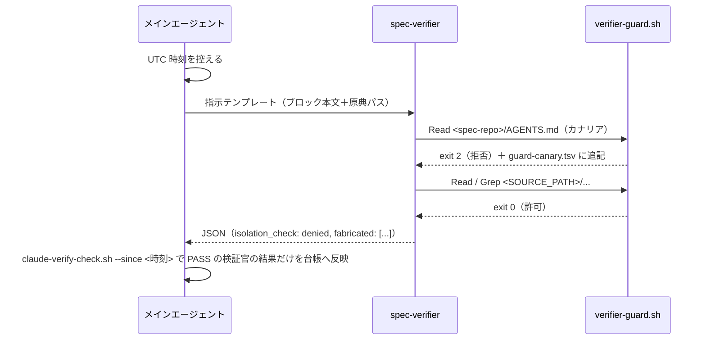

# Proposal: 検証官のコンテキスト隔離をホストの機能で強制する（Claude Code / Kiro CLI）

**状態**: 実装済み（harness 層: `hosts/claude-code/`・`hosts/kiro-cli/`。GP-107）
**対象ホスト**: Claude Code（2.1.305 で実測）、Kiro CLI（2.33.0 の V2 / V3 エンジンで実測）
**関連する規約**: GP-16 ルール2（コンテキスト隔離）・ルール8（段階的縮退）、SB-12（高影響宣言の独立検証）、GP-22（密度昇格の Verify 必須化）

---

## Background

reverse-spec-flow は、生成した仕様の正しさを**別の検証官（サブエージェント）による反証**で確かめる。
`purpose=rebuild` の完了条件 `fabricated_open=0` は、この検証が独立していることを前提にしている。

GP-16 ルール2 は、検証官に渡してよいものを次の 2 つに限っている（`skills/density-verify/SKILL.md` §2）。

- 生成ブロック本文
- 原典ファイルのパス

渡してはいけないのは、生成時の推論・要約・分析物（`02-analysis/`）・会話履歴・先入観を与える説明である。
理由は SB-12 のとおりで、**生成者の視野を引き継いだ検証官は、生成者と同じものを見落とす**。

これまでこの隔離は**指示文の規律**（何を渡すか）だけで守っていた。Kiro CLI への対応を検討する中で、
「Kiro ではサブエージェントの隔離が緩くなるのではないか」という指摘があり、両ホストで実測した。
その結果、**指示文で渡さなくても検証官が仕様リポジトリの内容を得られる経路が、両ホストに存在する**ことが分かった。

### 隔離を破る経路

| 経路 | 内容 | Claude Code | Kiro CLI V3 |
|---|---|---|---|
| 会話履歴 | 親の会話・推論が渡る | 渡らない | 渡らない |
| 起動時の指示ファイル | ホストが起動時に注入する規範 | CLAUDE.md（と `@` で取り込む AGENTS.md） | 起動ディレクトリ直下の AGENTS.md と `.kiro/steering/` |
| 経路 1: steering | ワークスペースの `.kiro/steering/` | 読まない | 起動時に注入する |
| 経路 2: 入れ子の AGENTS.md | アクセスしたディレクトリの AGENTS.md | 読まない | **アクセス時に注入する。読み取りが deny で拒否されても注入される** |
| 経路 3: 自分で読みに行く | Read / grep で分析物・仕様本文を開く | 読める | 読める |

経路 3 は両ホスト共通の、もともとあった穴である。経路 2 は Kiro V3 で新たに生じる穴だが、
入るのは規範（AGENTS.md）であって分析物ではない。

## Goals

- 検証官が**解析対象ソースの外を読めない**ことを、指示文ではなくホストの機能で強制する。
- 隔離が実際に働いたことを、**検証官の自己申告ではなく機械の記録**で確かめてから結果を採用する。
- 隔離が働かなかったとき（設定の漏れ・未承認のワークスペースなど）に、**黙って緩い結果を採用しない**（fail-closed）。
- Claude Code と Kiro CLI のどちらで回しても、同じ指示テンプレートで検証できる。ただし**分母の決め方が違う**——Claude Code の
  検証官は Grep で原典全域を自分で走査できるが、Kiro CLI の検証官は渡されたパスの read しかできない。唯一型・全称型の主張は、
  **母集団の走査コマンド（`G-POPULATION` が要求する「母集団:」行）の出力を【原典パス】に全部渡し、検証官がそれを全部読んだとき**
  に成立する（`kiro-verify.sh` が Read 数 ≥ パス数を機械で確かめる）。候補を生成側の判断で選んで渡した場合は「渡した集合の中で」の
  判定にしかならず、生成側の視野を引き継ぐ（Limitations）。各 harness の `entry.md` §5 が「この手段で検証できる主張の範囲」を持つ。

## Non-goals

- シェルを必要とする検証官（件数の検算官）の隔離。シェルのコマンド文字列はパスで閉じ込められない（Limitations 参照）。
- specs/ やコードグラフを読むことが任務に含まれる検証官（`spec-adversarial-audit` のレンズ反証者）の隔離。
- Claude Code と Kiro CLI 以外のホスト。**Kiro IDE は本提案の後に別の手段で確立した**（`spec-verifier` で起動し、`kiro-ide-verify-check.sh` でセッション記録から隔離を確かめる。設計は `dev/kiro-ide-verifier-isolation.md`、手順は `hosts/kiro-ide/entry.md` §5。2026-10-26 追記）。

## Proposal

**解析対象ソースだけを読める検証官**を、ホストごとに最も確実な手段で作る。手段はホスト固有なので
**harness 層（`hosts/<surface>/`。GP-107）に閉じ**、skill・手順書・GP-16 ルール2 には役割
（「読み取りを解析対象ソースの配下に機械で制限する起動手段」）だけを書く。

- **Claude Code**: 専用のサブエージェント定義 `spec-verifier` と、読み取りを `SOURCE_PATH` の配下に制限する
  PreToolUse hook `verifier-guard.sh` を組で配置する。
- **Kiro CLI**: カスタムエージェントではなく、**解析対象ソースをワークスペースにした別セッション**を起動するスクリプト
  `kiro-verify.sh` を配置する。仕様リポジトリをワークスペースの外に置くことで、経路 1・2・3 をまとめて塞ぐ。

どちらも、検証官に読まれたら隔離が破れていると判断できる目印のファイル（**カナリア**）を置く。そのうえで検証官に実際に読ませ、
拒否されたことを機械で確かめた結果だけを採用する。

## Solution Components

フレームワーク側（harness 層）:

```
hosts/
├── claude-code/
│   ├── agents/spec-verifier.md      Claude Code の検証官の定義
│   ├── hooks/verifier-guard.sh      読み取りを SOURCE_PATH の配下に制限する hook
│   ├── entry.md                     §5「検証官の隔離」= 起動方法と隔離の確かめ方の正本
│   └── placement.sh                 上の 2 つを .claude/ へ置く
└── kiro-cli/
    ├── kiro-verify.sh               Kiro CLI の検証官の起動スクリプト
    ├── entry.md                     §5「検証官の隔離」
    └── placement.sh                 kiro-verify.sh を 03-audit/ へ、skill を .kiro/skills/ へ置く
```

生成先（`./init.sh … --host claude-code` と `--host kiro-cli` のそれぞれ）:

```
<spec-repo>/
├── HOST.md                          使っているホストの entry.md の写し（init.sh / apply-host.sh が置く）
├── AGENTS.md                        規範の入口（.kiro/steering/ は作らない）
├── .claude/                         ── --host claude-code のとき
│   ├── agents/spec-verifier.md
│   ├── hooks/verifier-guard.sh
│   └── skills/
├── .kiro/skills/                    ── --host kiro-cli のとき
└── spec-extraction/
    ├── 00-ingestion/gate-config.env SOURCE_PATH='<解析対象ソースの絶対パス>'
    └── 03-audit/
        ├── kiro-verify.sh           ── --host kiro-cli のとき
        └── verify-log/guard-canary.tsv  hook がカナリアを拒否した記録（--host claude-code）
```

`SOURCE_PATH` は init.sh が `gate-config.env` に書く値で、hook と `kiro-verify.sh` の両方がここから読む。
skill・手順書は「`HOST.md` の『検証官の隔離』節に従う」と書くので、**`entry.md` を生成先へ写すことが実行時の契約の一部**になる
（写さないと、手順書が指す正本が実行時に存在しない）。

### Claude Code: `spec-verifier` と `verifier-guard.sh`

#### 定義（`hosts/claude-code/agents/spec-verifier.md`）

```yaml
tools: Read, Grep, Glob     # Bash を入れない（hook がコマンド文字列を判定できないため）
model: inherit
omitClaudeMd: true          # CLAUDE.md と、@ で取り込まれる AGENTS.md を注入させない
hooks:
  PreToolUse:
    - matcher: "Read|Grep|Glob"
      hooks:
        - type: command
          command: '... verifier-guard.sh を探して実行。見つからない・失敗も exit 2 ...'
```

定義の本文はそのまま検証官の system prompt になる。このため本文には検証官への指示（カナリアの手順・読んでよい範囲・
出力の必須欄）だけを置き、検証の姿勢と検査項目は skill の指示テンプレートを正本にする（Kiro と共通にするため）。
保守者向けの説明は hook の冒頭に置く。

#### パス制限 hook（`hosts/claude-code/hooks/verifier-guard.sh`）

- **許可リスト方式**: `SOURCE_PATH` の配下だけを通す。仕様リポジトリを列挙して拒否する方式にしないのは、
  写しや親ディレクトリからの再帰検索で回り道できるため（実測: path を省いた Grep、親を path にした Grep が分析物に届いた）。
- **パスは実体で判定する**: シンボリックリンクと `..` を辿った先で判定する。Grep / Glob は path の省略を拒否し、
  パターンの中の絶対パス・`~`・`..`・波括弧の中の絶対パスも拒否する。
- **fail-closed**: Claude Code は **exit 2 だけを拒否**として扱い、それ以外の非 0 では**ツール呼び出しを通す**。
  判定できない入力（設定が無い・JSON を解釈できない・同じキーが 2 回現れる）はすべて exit 2 にし、
  想定外の終了も `trap … EXIT` で exit 2 に写す。
- **依存は bash と coreutils だけ**（フレームワークの依存ゼロの方針）。jq を使わず、解釈に自信が持てない値は拒否する。
- **カナリアの記録**: 仕様リポジトリの AGENTS.md（ルート・`spec-extraction/`・`specs/`）への読み取りを拒否したときだけ、
  `guard-canary.tsv` に `時刻<TAB>agent_id<TAB>パス` を 1 行追記する。

#### 隔離の確認（`hosts/claude-code/entry.md` §5）

検証官は最初に作業ディレクトリ直下の AGENTS.md（カナリア）を読もうとし、hook に拒否される。メインエージェントは:

1. 起動前に UTC 時刻を控える。
2. 完了後に `spec-extraction/03-audit/claude-verify-check.sh --since <時刻>` を 1 回走らせる。スクリプトは Claude Code の
   セッション記録を検証官ごとに読み、C1（spec-verifier で起動したか）・C2（verifier-guard の拒否が記録にあるか＝hook が動いたか）・
   C3（読み取りが解析対象ソースの配下だけか）を確かめる。
3. `FAIL` の検証官の結果、または `isolation_check: denied` を返さなかった結果は、集計にも台帳にも入れない（その検証官の結果だけを捨てる）。

> v2.1.0 までは「起動前に `guard-canary.tsv` の行数を控え、新しい行の agent_id の異なる値が起動数以上あるか」を
> 起動のたびに確かめさせていた（確認の窓）。並列のバッチを窓にまとめるための取りまとめ役が生まれて費用が膨らみ、
> カナリアのパスを取り違えた検証官（拒否されても行が残らない）で照合が外れて巡ごと無効になったため、事後の確かめに置き換えた
> （`hosts/claude-code/MEASURED.md` 追補 V-6）。

#### 検証 1 回の流れ



### Kiro CLI: `kiro-verify.sh`

#### 起動条件

```bash
cd "$SOURCE_PATH" && kiro-cli chat --v3 --no-interactive --trust-tools= "<制約の前置> + <指示文>"
```

- **解析対象ソースをワークスペースにする**: 仕様リポジトリの steering・AGENTS.md はワークスペースの外なので読み込まれない
  （経路 1・2）。Kiro はワークスペースの外の AGENTS.md を発見しない。
- **外への読み取りは境界で止める**（経路 3）: ワークスペースの外へのアクセスは「確認待ち」になり、非対話モードでは拒否される。
  `--trust-all-tools` は**付けない**（ワークスペースの外への読み取りまで承認してしまう）。
- **カスタムエージェントの `permissions` は使わない**: ワークスペースの外のパスへの deny は効かなかった（Alternatives 参照）。
- 指示文は引数で渡す。ファイルを読ませないので、指示文ファイルは仕様リポジトリの中にあってよい。
- **何も信頼しない（`--trust-tools=`）**。ワークスペースの中の read は Kiro の既定の許可（`fs_read` は `./**` を自動許可）で通り、
  外は非対話で拒否される。**ツール ID（`read_file`）を `--trust-tools` に書くと境界を問わず承認され、外も読める**
  （2.34.0 で実測。探針のカナリアが読めて rc=3 に倒れる。追補 V3-1 #9）。V3 に `grep` / `glob`（`grep_search` / `file_search`）という
  ツールは存在せず、検索の要求はシェルに落ちて拒否される（追補 V3-1、3/3）。
  初版は `--trust-tools=read,grep,glob` と書いていたが 3 つとも実在しない ID で、読めていたのは既定の許可のおかげだった。**検証官は渡されたパスの読み取りだけで判定する**ので、
  スクリプトは指示文の前に「使えるツールは Read だけ・渡されたパスだけを読む」を前置し、検証本体で拒否が 1 件でもあれば rc=6 で結果を捨てる
  （初版は拒否行を出力から除いて rc=0 で返しており、**検索できなかった検証が「隔離できた検証」として台帳に載る** fail-open だった）。
  原典を横断して反例を探す検査（唯一型・全称型・件数）はこの検証官ではできない（`hosts/kiro-cli/entry.md` §5 の表）。

#### カナリア探針

検証の前に、同じ起動条件の別セッションで境界が働くことを確かめる。

1. `mktemp -d` で**仕様リポジトリとソースの両方の外**に一時ディレクトリを作り、推測できない値（nonce）を書いたファイルを置く。
2. 「このファイルを読み、読めた内容をそのまま表示せよ。読めなければ CANARY_DENIED とだけ表示せよ」と指示した探針を起動する。
3. 同じ探針で、原典の既知ファイル（1 行目が印字可能 ASCII のテキスト。先頭 200 件から選ぶ。書き込まない）の 1 行目も表示させる。
4. 次の 3 点を機械で確かめる。満たさなければ検証せずに終了する（rc=3）。
   - nonce が出力に現れない（空白で区切られていても検出する）
   - kiro-cli が拒否を報告した（`[denied]` 行。色付き・字下げも認める）
   - **原典の 1 行目が出力に現れる**（陽性対照。read の信頼が効いていなければ検証官は何も読めず、読まずに判定した結果が
     「隔離できた検証」に化ける。「外を読めない」だけでは区別できない）

探針を検証本体と分けるのは、検証本体の `[denied]` が「外を読もうとした」のか「検索を試みた」のか区別できないためである
（本体の `[denied]` は別に数え、1 件でもあれば rc=6 で結果を捨てる）。カナリアを仕様リポジトリの中に置かないのは、
Kiro V3 がアクセスしたディレクトリの AGENTS.md を拒否されても注入するため（カナリア自身が注入の入口になる）。

#### 終了コード

| rc | 意味 | 結果の扱い |
|---|---|---|
| 0 | 探針で隔離を確認し、検証結果を得た | 標準出力を検証結果として使う |
| 2 | 前提を満たさない（設定・配置・kiro-cli が V3 に非対応・ソースと仕様リポジトリが入れ子・陽性対照に使える原典ファイルが無い） | 検証していない |
| 3 | 探針で隔離を確認できない（nonce が読めた・拒否の報告が無い・原典の 1 行目が読めない） | 検証していない |
| 4 | 解析対象ソースが変更された（SB-5） | 使わない |
| 5 | kiro-cli が異常終了した | 使わない |
| 6 | 検証本体で拒否された操作がある（検証官が read 以外を試みた） | 使わない |
| 7 | 検証本体でツール呼び出しが 0 件、または【原典パス】の件数未満（原典を読まずに／全部は読まずに判定した） | 使わない |

### 共通: skill と規範

- **skill は harness ごとの場所に置く**（claude-code は `.claude/skills/`、kiro-cli は `.kiro/skills/`）。Kiro V3 は `.claude/skills/` を読まない。
  V2 は両方を読み、同名なら `.kiro/skills/` を使う（重複表示はしない）。
- **skill の本文はホストを知らない書き方にする**（GP-107 ルール1）。Kiro V2 は `.claude/skills/` の本文もそのまま手順として使うため、
  Claude Code 専用の書き方にすると Kiro が CC 用の手順を実行しようとする。起動方法と隔離の確かめ方は
  各 harness の `entry.md` §5（生成先の `HOST.md`）を正本にする。
- **規範は AGENTS.md に一本化し、生成先に `.kiro/steering/` を作らない**。経路 1 を構造的に無くす。
- 実行時の契約（手順書 Step 4-5d・GP-16 ルール2）にも役割を書く。手順書に無いルールは実行時には存在しないため。

## 実測したホストの挙動

設計はすべて次の実測に基づく。版が変わると挙動が変わりうるので、版を併記する。
判定の多くはモデルの自己申告に基づくため、**現れたトークンは漏れの証拠になるが、現れなかったことは漏れていない証明にならない**。

| # | 挙動 | ホスト・版 |
|---|---|---|
| 1 | サブエージェントに親の会話履歴は渡らない | CC 2.1.305 / Kiro 2.33.0（V2） |
| 2 | サブエージェントにも CLAUDE.md（と `@` で取り込む AGENTS.md）が注入される。`omitClaudeMd: true` で止まる | CC 2.1.305 |
| 3 | 入れ子の AGENTS.md は読まない | CC 2.1.305 / Kiro V2 |
| 4 | アクセスしたディレクトリの入れ子 AGENTS.md を注入する。読み取りが deny で拒否されても注入される。入れ子の `.kiro/steering/` は注入しない | Kiro V3 |
| 5 | カスタムエージェントの `permissions` の deny はワークスペースの中にしか効かない（外のパスは絶対パス・`**/x/**`・`~/x` のどれでも無視された） | Kiro V3 |
| 6 | `chat.disableInheritingDefaultResources` を設定しても注入は変わらない | Kiro V3 |
| 7 | 非対話モードではワークスペースの外へのアクセスが拒否される。`--trust-all-tools` を付けると承認される | Kiro V3 |
| 8 | ~~grep / glob はワークスペースの外を検索できない~~ → **V3 に `grep` / `glob`（`grep_search` / `file_search`）というツールは無い**。検索の要求はシェルに落ち、非対話では拒否される（2026-10-26 の再測定 3/3。`hosts/kiro-cli/MEASURED.md` 追補 V3-1。初版の観測はシェルの拒否を見ていた可能性が高い） | Kiro V3 |
| 9 | プロジェクト定義の frontmatter hook は、ワークスペースの信頼ダイアログを承認するまで動かない（`claude -p` は承認扱いにならない）。`tools` と `omitClaudeMd` は効く | CC 2.1.305 |
| 10 | `.claude/skills/` を V2 は読み、V3 は読まない。V3 は `.kiro/skills/` を読む | Kiro 2.33.0 |
| 11 | 非対話モードで shell だけを信頼させる `--trust-tools` の名前は見つからなかった | Kiro V3 |

測り方は、フィクスチャの各ファイルに一意のトークンを埋め、検証官の出力とセッション記録に現れるかを見るものだった。
実測の記録と、測定で踏んだ罠（description を `[` で始めると skill が黙って消える等）は `dev/developing-the-framework.md` の教訓 63 にある。

## Alternatives considered

| 案 | 採らなかった理由 |
|---|---|
| 指示文の規律だけで隔離する（従来） | 検証官が分析物を自分で読みに行ける（経路 3）。Kiro V3 では経路 2 もある |
| Claude Code の `permissions.deny` で分析物を塞ぐ | セッション全体に効くので、分析物を読む必要があるメインエージェントまで止めてしまう |
| Kiro のカスタムエージェントの `fs_read` deny で塞ぐ | ワークスペースの外には効かない（実測 #5）。ワークスペースの中でも、拒否したディレクトリの AGENTS.md は注入される（実測 #4） |
| Kiro の `chat.disableInheritingDefaultResources` で注入を止める | V3 では効かなかった（実測 #6） |
| 仕様リポジトリの中で別セッションを起動する（GP-16 ルール8 の縮退） | Kiro V3 は、アクセスしたディレクトリの AGENTS.md を取り込む（実測 #4）。ワークスペースの中なので経路 3 も塞がらない |
| 専用の空ディレクトリをワークスペースにして起動する | 外への deny が効かず仕様リポジトリを読めた。原典（ワークスペースの外）は読めない（実測 #5・#7） |
| カナリアを仕様リポジトリの AGENTS.md にする（Kiro） | カナリアへのアクセス自体が AGENTS.md の注入の入口になる（実測 #4） |
| カナリアの合否を検証官の自己申告で決める | 自己申告は検証の対象そのもの。hook の記録（CC）と kiro-cli の拒否行（Kiro）で決める |
| hook を Python で書く | フレームワークは bash と Markdown だけで動く方針。Python は環境によって無い |
| Kiro 用にもカスタムエージェント定義を作り、CC と共通化する | Kiro では隔離にも寄与しない（実測 #5・#6）。ソース側に置けば SB-5 に反し、`~/.kiro/agents/` に置けば init.sh がリポジトリの外に書くことになる |

## Limitations and Security Considerations

- **Kiro CLI の検証官は渡されたパスの read しかできない**（V3 に検索ツールが無い。追補 V3-1）。反例が存在しうる全域（分母）を
  検証官が自分で決められないので、唯一型・全称型・不在型は**分母を誰が決めたか**で意味が変わる:
  - 【原典パス】が**母集団の走査コマンドの出力**なら、検証官は分母の定義（コマンド）と全要素を受け取っており、分母の中の反例探索は
    独立に行える。`kiro-verify.sh` は Read 数が【原典パス】の件数未満なら rc=7 で結果を捨てる（途中で読むのをやめた結果を採らない）。
    残るのは走査コマンド自体の正しさ（目印の系統の漏れ）で、それは §2b の検算官の仕事（Kiro では `prompt-isolated`）。
  - 【原典パス】を生成側が判断で選んだなら、得られるのは「渡した N 件の中で唯一」であって「原典全体で唯一」ではない。
    生成側が見落としたファイルは候補に入らず、検証官はそこを見に行けない（SB-12 の「生成者の視野を引き継ぐ」そのもの）。
    この形で `verified` にしない。
  - 件数の主張（`density-verify` §2b）はシェルの走査が要るので、いずれにせよこの検証官ではできない。
  実務上の上限: 検索ツールが無いので 1 ファイル 1 Read。候補が数十件を超えると実時間とコンテキストを食う。
- **シェルを使う検証官は対象外**。件数の検算官（`density-verify` §2b）は Claude Code では汎用のサブエージェントで起動し、
  隔離は指示文の規律に頼る。Kiro では起動方法が未確立で、段階的縮退（別コンテキスト再検証 → 人間サインオフ）で行う。
  いずれも台帳の notes に `count-verifier: prompt-isolated` と残す。
- **specs/ を読むレンズ反証者は対象外**（`spec-adversarial-audit` 手順 2）。任務と「ソースだけ」が両立しない。
- **Claude Code はワークスペースの信頼が前提**。未承認だと hook が動かない（実測 #9）。この場合カナリアの記録が増えないので、
  skill の手順で結果は捨てられる（fail-closed）。
- **シンボリックリンクのディレクトリ**: hook は Grep / Glob の起点の path だけを判定する。解析対象ソースの中に外を指す
  ディレクトリのリンクがあると、再帰検索がリンク先へ入りうる（Claude Code の走査がリンクを辿るかは未実測）。
- **規範の注入は残る**（Kiro）: 解析対象ソース自身の AGENTS.md・steering と、ユーザー全体の `~/.kiro/steering/` は入る。
  生成物ではないので目隠しの対象外とした。Claude Code でも、git status のスナップショットと MCP サーバーの instructions は入る。
- **検証は 1 回ごとに新しいプロセス**（Kiro）なので、Claude Code のように並列のサブエージェントを束ねるより時間がかかる。
- **解析対象ソースをワークスペースにする**（Kiro）: 多ホスト対応プランの決定事項 #8 は「解析対象をワークスペースに入れない」としている。
  `kiro-verify.sh` はこれの例外で、**読み取り専用の検証官セッションに限る**。信頼するのは read だけで、
  解析対象の変更を検出したら結果を捨てる（rc=4。SB-5）。生成を行うメインのセッションは従来どおり入れない。
- **未検証**: Kiro の未信頼ワークスペースでの skill の扱い（ドキュメントは「読まない」とするが、実測では発見された）。

## Troubleshooting

| 症状 | 原因 | 対処 |
|---|---|---|
| CC: 検証官が `{"isolation_check": "READ_SUCCEEDED"}` だけを返す | hook が動いていない（信頼ダイアログ未承認・`claude -p`） | ワークスペースを信頼してから起動し直す |
| CC: `claude-verify-check.sh` が C1 / C2 で FAIL | 一部の検証官が spec-verifier 以外で起動された（C1）、または hook が動いていない（C2） | その検証官の結果を捨て、`subagent_type: spec-verifier` で起動し直す（C2 は信頼ダイアログを承認してから） |
| CC: すべての読み取りが「verifier-guard.sh が見つからない」で拒否される | hook のスクリプトを `$CLAUDE_PROJECT_DIR` と git のルートのどちらからも見つけられない | 生成先リポジトリの中で起動する |
| Kiro: rc=2「V3 エンジンに対応していない」 | kiro-cli が古い | `kiro-cli chat --help` に `--v3` が出る版にする |
| Kiro: rc=3「拒否を報告していない」 | `--trust-all-tools` 相当の設定がある、またはワークスペースの判定が変わった | ユーザー設定の permissions と kiro-cli の版を確認する |
| Kiro: rc=3「原典の既知ファイルを読めなかった」 | ワークスペース内の読み取りの既定の許可が効いていない（利用者の `permissions.yaml` で `fs_read` を ask/deny にしている、または版で既定が変わった） | `~/.kiro/settings/permissions.yaml` と公式ドキュメントの Default behavior を確かめる。読めるようになるまで検証しない |
| Kiro: rc=3「カナリアを読めた」 | `--trust-tools` に read のツール ID を書いた、`--trust-all-tools` 相当の設定がある、または `fs_read` を全域 allow にしている | `KFLAGS` を `--trust-tools=` に戻す。利用者の permissions を確かめる |
| Kiro: rc=7 | 検証官が原典を 1 件も読まずに判定した、または【原典パス】の一部しか読まなかった | 指示文の【原典パス】がファイルを指しているか確かめる（ディレクトリは列挙できない）。件数が多すぎるならブロックか母集団を分割する。結果は捨てる |
| Kiro: rc=6 | 検証官が検索やシェルを試みた（渡されたパスだけで判定できない主張が含まれる） | 原典パスに候補ファイル群をすべて列挙して渡す。唯一型・全称型・件数は GP-16 ルール8 の縮退へ |
| Kiro: rc=4 | 解析対象ソースの中のファイルが更新された | 変更されたパスを確認する（Kiro がワークスペースに状態を書いた可能性も含む） |

## Testing

- **selftest**（`./selftest.sh` T1h の「検証官の隔離（GP-16 ルール2）を機械で強制する配布物」）:
  - `--host claude-code`（既定）の生成物に定義と hook が置かれ、`--host kiro-cli` の生成物に `kiro-verify.sh` と `.kiro/skills/` が置かれ、
    どちらにも他方の配置物と `.kiro/steering/` が無いこと。`HOST.md` が使ったホストの `entry.md` の写しであること
  - 定義の 3 点（tools・`omitClaudeMd`・hook）、本文に保守用の説明を置かないこと
  - hook の判定を、生成物の hook を複製した模擬リポジトリで 2 つのロケールで実行する（許可 2 件・拒否 17 件・カナリアの記録）
  - `kiro-verify.sh` を模擬 kiro-cli で実行し、起動場所・フラグ（read だけを信頼）・探針（カナリア＋陽性対照）・本体の拒否（rc=6）・
    `SOURCE_PATH` の 4 書式・終了コードを確かめる
  - skill の frontmatter が Kiro と YAML の制約を満たすこと、skill・手順書がホスト固有の名前を持たず `HOST.md` を指すこと
  - 全 harness の `entry.md` が「検証官の隔離」節を持つこと
- **実データでの確認**（開発時に実施）: 公開 OSS の Java Web アプリに対して生成した仕様リポジトリで、実際の仕様ブロックと、
  誤りを 3 件仕込んだブロックを両ホストで検証した。仕込んだ誤りは両ホストとも 3/3 検出し、漏れ検出用トークンは
  セッション記録に 0 件、攻撃的な読み取りの試み 7 種はすべて仕様リポジトリに届かなかった。

## Future

- Kiro で件数の検算官を隔離して起動する方法を確立する（ワークスペースの信頼と shell の信頼の関係を測る）。
- Claude Code の Grep / Glob がシンボリックリンクのディレクトリを辿るかを測り、必要なら hook で塞ぐ。
- ~~Kiro IDE での挙動を確かめる。~~ → 済（Non-goals の追記を参照）。
- ホストの版が上がったら、「実測したホストの挙動」の表を測り直す（表の各行が設計の前提になっている）。
