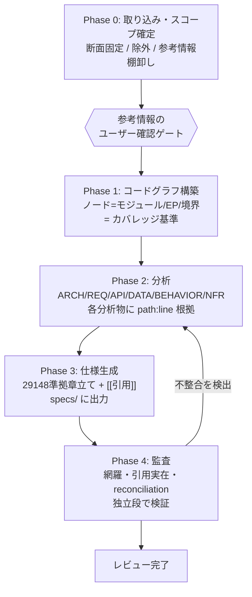

# reverse-spec-flow — エンジニア向け解説

> 既存コードから AI エージェント向けの仕様書（AI フレンドリーな仕様書）を、根拠付き・網羅を数値で確かめながら起こす AI 駆動ワークフロー
>
> 対象読者: reverse-spec-flow（以下、本フレームワーク）を使ってレガシーシステムの仕様化・再構築を検討/実施するエンジニア
> 構成要素: 生成プロセス規約 `GP-N`（pipeline.md）/ 品質不変条件 `SB-N`（playbook.md）/ 実運用フィードバック `FB-N`

> **このドキュメントは「設計思想と課題背景」を説明します。**
> 実際に使うときの「何をすると何が起きるか / AI は何に縛られているか / 止まったときどうするか」は
> **[how-it-works.md（仕組み解説・利用者向け）](how-it-works.md)** が正本です。
> ゲートの一覧・Tier と HOLD・Playbook・密度昇格の運用はそちらを参照してください。

---

## 目次

1. [これは何か（要点）](#1-これは何か要点)
2. [解こうとしている課題](#2-解こうとしている課題)
3. [基本コンセプト](#3-基本コンセプト)
4. [全体像 — 5 フェーズ生成パイプライン](#4-全体像--5-フェーズ生成パイプライン)
5. [成果物の構造 — 2 層仕様モデル](#5-成果物の構造--2-層仕様モデル)
6. [品質をどう担保するか](#6-品質をどう担保するか)
7. [知見体系 — GP-N と SB-N](#7-知見体系--gp-n-と-sb-n)
8. [使い方 — セットアップから完走まで](#8-使い方--セットアップから完走まで)
9. [スケール戦略 — 大規模コードベースと並列化](#9-スケール戦略--大規模コードベースと並列化)
10. [本フレームワークが担うこと／担わないこと](#10-本フレームワークが担うこと担わないこと)
11. [生成される成果物の例（Apache Roller）](#11-生成される成果物の例apache-roller)
12. [FAQ](#12-faq)
13. [用語集](#13-用語集)

---

## 1. これは何か（要点）

- **何を**: 既存のソースコードを解析し、**設計・振る舞い・データ・API・再構築仕様**を、AI エージェントが読んで使うための Markdown（AI フレンドリーな仕様書）として生成する。
- **何に使うか**: 仕様書を入力にした**仕様駆動開発でのアプリケーションの再構築**と、機能追加・仕様変更・リファクタリング・移行に伴う改修を検討するための**現行仕様の確認**。人も読めるが、主な読み手は AI エージェント。
- **どうやって**: AI ツール（Claude Code・Kiro）上の AI エージェントに、**段階パイプライン**と**品質の不変条件**を規約として与えて駆動する。
- **最も重視すること**: (1) **正しさ** — 全記述に `path:line` の根拠を付け、作成とは切り離した検証役の AI エージェントが解析対象のソースコードと突き合わせ、確かめられないことは `UNKNOWN`（未確定）として残す。(2) **網羅** — 先にコードグラフ（分母）を作り、全要素を仕様化するまで完了にしない。どちらも完了の判定は `gates.sh` が行う。
- **そのほかの特徴**: bash・git と AI ツールだけで動く（DB などの基盤は不要）。AI ツール固有の部分は `hosts/` に分離している。

一言でいえば「**AI に自由作文させず、検証可能な手続きで仕様を"抽出"させる**」フレームワークです。

---

## 2. 解こうとしている課題

レガシーシステムの仕様化・再構築（モダナイズ）では、次の壁にぶつかりがちです。

| 課題 | 具体的に起きること |
|------|------------------|
| **仕様書が存在しない/陳腐化** | 唯一の真実はコードだけ。設計書は数年前で止まり、コードと矛盾している。 |
| **AI にコードを丸ごと要約させると危険** | それらしいが誤った仕様（ハルシネーション）が混入し、下流の再実装・保守判断に伝播する。 |
| **「書いた部分」しか見えない** | 網羅したのか、書き漏らしたのか判別できないまま「完成」と誤認する。 |
| **現行スタックに引きずられる** | サービスクラス構造・ORM・特定フレームワークの都合が「仕様」に混入し、新スタックで作り直せない。 |
| **画面・帳票・バッチが抜ける** | UI テンプレート、帳票の集計ルール、ジョブの実行順序（多くは外部ツール）が仕様から欠落する。 |

本フレームワークは、これらを**「仕組み（プロセスと不変条件）」で防ぐ**ことを狙います。個々の AI の賢さに頼るのではなく、誤りが混入しにくい手続きに落とし込みます。

---

## 3. 基本コンセプト

### 3.1 コードを「直接要約しない」— 中間表現を挟む

ソース全体を一度に AI に読ませて仕様を書かせると、網羅の抜けと根拠のない要約が混入します。そこで、
**取り込み → コードグラフ → 分析 → 仕様生成 → 監査** と段を分け、各段の出力を次段の**検証可能な入力**にします（GP-1）。

```
     ┌─────────┐   ┌───────────┐   ┌────────┐   ┌───────────┐   ┌────────┐
     │ 取り込み │→ │コードグラフ│→ │  分析  │→ │  仕様生成  │→ │  監査  │
     └─────────┘   └───────────┘   └────────┘   └───────────┘   └────────┘
      断面固定       構造マップ      根拠付き分析   29148準拠仕様   網羅・引用検証
      スコープ       =網羅の基準     ARCH/REQ/…    [[引用]]付き    独立段で検証
```

### 3.2 すべての仕様記述に「根拠」を紐づける — トレーサビリティ

生成した仕様の各文は、**分析物 ID → コードの `path:line`** という 2 段リンクで裏付けます（GP-4）。
仕様のどの一文も、機械的にコードまで遡れます。引用のない断定文は残しません。

```
仕様書の記述  ──[[REQ-03, API-01]]──▶  分析物(Phase2)  ──path:line──▶  実コード
   (Phase 3)                            (根拠の中間物)              (唯一の真実)
```

### 3.3 「事実」と「推測」を分離する

コードから確定できる事実（入出力・分岐・データ構造）と、意図の推測を混ぜません。確定できないことは
削除も断定もせず、`🔍 UNKNOWN` として本文に可視化します（GP-5, SB-4）。「分からないことが分かる」状態を作ります。

### 3.4 既存の設計書・仕様書を「コンテキスト補強」として活かす

コードは **WHAT / HOW（何を・どう動くか）** を正確に示しますが、**WHY（なぜそうなっているか・意図・背景）** は
ほとんど語りません。既存の設計書・仕様書・操作マニュアル・Wiki・ADR・コード内コメント、さらに Excel 設計書や
画面画像・アーキ図・PDF といった資料には、この WHY と全体像が眠っています。本フレームワークは、これらを
**コンテキストを補強する参考情報として積極的に取り込みます**（GP-12）。

**取り込むメリット:**

| メリット | 内容 |
|---------|------|
| **WHY・意図が補える** | コードだけでは分からない「なぜこの設計か」「どんな業務要件から来たか」を設計書から補い、仕様の理解を深める。 |
| **全体像を早くつかめる** | 設計書は探索の道標になる。「どこを読むべきか」の当たりがつき、大規模コードの解析が速く・正確になる。 |
| **画面・帳票・外部ジョブ制御を補完** | コードに現れにくい情報（画面レイアウト、帳票サンプル、JP1 等のジョブ実行順序）を資料から補える。 |
| **ドキュメントの陳腐化そのものが発見になる** | 設計書とコードの矛盾（doc↔code ドリフト）を検出でき、保守・引き継ぎで価値の高い情報になる。 |

一方で、設計書は**コードと同期が取れていないことが多く**、古い・願望・誤りといったノイズを含みます。そこで、
参考情報を「事実」ではなく **「出所付きの、検証待ちの主張（claim）」** として一段別に扱い、**コードで裏取りしてから**
仕様に昇格させます。この扱いを「**証拠の階層**」と呼びます。

| 出所 | 扱い |
|------|------|
| コードで実証できた | **事実**として仕様に確定（`path:line`） |
| 設計書の主張 → コードで裏取り成功 | 事実に格上げ。加えて WHY/意図も補える（`[[REF-n]]` ＋ `path:line`） |
| 設計書にあるがコード未確認 | **事実にしない**。「文書記載・未検証」と明示し、意図/背景として区別 |
| 設計書とコードが矛盾 | **コードを正**とし、乖離を「ドリフト」として記録（第一級の発見） |

> こうすることで、「設計書を使わず WHY が永久に欠落する」ことも、「設計書を鵜呑みにして誤情報が下流に伝播する」ことも
> 両方防ぎます。**設計書の価値（WHY・全体像）は取り込みつつ、真実はコードに置く** ── これが参考情報活用の要点です。

なお、マルチモーダル資料（Excel・画像・PDF）は「抽出」という工程を経てテキスト化するため、元資料の位置（locator）と
抽出方法・忠実度も記録します。棚卸しした参考情報は、コード解析に入る前に**ユーザー確認ゲート**を通し、取捨選択や
読み取りの妥当性・不足資料の有無をレビューします（認識齟齬を早期に潰す）。

### 3.5 解析対象は「参照専用」— 非破壊

解析対象のソースは読むだけで、**変更もコピーもしません**（SB-5）。成果物（仕様書）は別の独立した git リポジトリに隔離します。

### 3.6 依存ゼロ・ツール非依存

プラットフォーム基盤（グラフ DB・ベクター DB・エンベディング）を**持たない・要求しない**。
「コードグラフ」は物理 DB ではなく AI が書く **Markdown の構造マップ**。コード探索は**ホストの AI ツールの検索能力に委譲**します。
これがツール非依存の核心です。並列実行はホストが持つなら使いますが、**並列実行が無くても（逐次でも）品質は成立**します。

> **コードグラフが Markdown（ローカルファイル）で大規模に耐える理由**: コードグラフに載るのは
> モジュール・エントリポイント・外部境界（ノード）と依存・呼び出し（エッジ）**だけ**で、関数の中身は載りません。
> いわば「本文」ではなく「目次」です。実測では **約 85,000 行・540 ファイル（`app/src/main/java`）のコードに対しコードグラフは 238 行（約24KB）**。
> コード量が増えてもグラフは緩やかにしか増えないため、ファイルサイズが制約になることは実質ありません。
> 大規模で本当に効くのはコンテキスト（AI が一度に読める量）の管理で、そこは縦串分割（GP-10）で 1 作業単位を一定に保ちます（[9 章](#9-スケール戦略--大規模コードベースと並列化)）。

---

## 4. 全体像 — 5 フェーズ生成パイプライン

各フェーズは中間生成物を経て段階的に仕様を構築します。フェーズ完了ごとにユーザーレビューを挟みます。

| Phase | 名称 | 作業拠点 | 主な生成物 | 目的 |
|-------|------|---------|-----------|------|
| **0** | 取り込み・スコープ確定 | `00-ingestion/` | 断面固定（コミット）・スコープ/除外・固有文脈・参考情報インベントリ | 何を・どの版で仕様化するか固定する |
| **1** | コードグラフ構築 | `01-code-graph/` | 構造マップ（ノード=モジュール/エントリポイント/境界、エッジ=依存/呼び出し） | 網羅の基準を先に作る |
| **2** | 分析 | `02-analysis/` | カテゴリ別分析物（ARCH/REQ/API/DATA/BEHAVIOR/NFR、根拠 `path:line` 付き） | コードを観点別に読み解く |
| **3** | 仕様生成 | `specs/` | 29148 準拠章立ての仕様（`[[分析物ID]]` 引用＋検証付き） | AI エージェントが引ける形の仕様書を作る（人も読める） |
| **4** | 監査 | `03-audit/` | 網羅性突合・引用実在検証・reconciliation | 生成物を独立に検証する |

### フェーズの流れ図



> **なぜ監査を独立段にするのか**: 生成した本人（AI）が同じ思考のまま自己確認すると誤りを見逃します。
> 生成とは観点を変えた独立の検証段を設けます（GP-6）。さらに別エージェントに「反証」させる敵対的検証も選べます（GP-16）。

---

## 5. 成果物の構造 — 2 層仕様モデル

本フレームワークの成果物は「保守理解」だけでなく「**新しい技術スタックでの再構築**」の入力になります。
再構築は現在の技術スタックに縛られず自由に設計されるため、仕様を 2 層に分離します（GP-13）。

| 層 | 内容 | 性質 | 役割 |
|----|------|------|------|
| **(A) 実装事実層** | `specs/modules`, `api`, `data`, `behavior` | as-is・技術依存を含む | 本質を抽出する**根拠**。捨てない |
| **(B) 技術非依存の本質仕様層** | `specs/rebuild/` | to-be 中立 | 再構築の**入力**。現スタックの語彙を排する |

### 振り分けの判断規準

> **「この情報は、再構築先スタックが何であっても必要か? それとも現スタック（の実装機構）だから必要なだけか?」**

| 情報 | 振り分け |
|------|---------|
| ビジネスルール・状態遷移（例: 未来公開→予約扱い） | (B) 本質仕様へ |
| 論理データモデル（エンティティ・属性・関係・不変条件） | (B)。ORM 型・DDL 方言は (A) |
| ユーザーとの相互作用（ユースケース・操作フロー） | (B)。UI/CLI/API どの形態でも必要 |
| バリデーション規則（「タイトル必須」等の論理） | (B)。検証定義ファイル等の実装機構は (A) |
| 対外契約（既存 URL・フィード形式・既存データ） | (B)。互換性要件として保持 |
| サービスクラス構造・DI 配線・ORM・特定 Web フレームワーク | (A) のみ。再構築入力にしない |

> **重要な注意**: 再構築先スタック（SPA/CLI/マイクロサービス等）を**判断の前提にしません**。「SPA だから画面が要る」のように
> 特定の再構築先を前提にすると、その前提が外れたとき判断を誤ります。再構築先は未定・自由と考え、**どんな再構築先でも共通して必要な本質**を仕様化します。

### 生成される全体構造

```
<source>/                    解析対象（参照専用・変更しない・コピーしない）
<source>-spec/               ★独立した git リポジトリ (branch: spec/<spec-name>)
  ├── specs/                 成果物
  │   ├── AGENTS.md          仕様書を使う側の規範
  │   ├── source-index.md    ソース→仕様書の逆引き索引
  │   ├── overview.md        全体像（29148 SRS §1-2 + 非機能属性 + 利用/運用ビュー）
  │   ├── modules/           (A) モジュール別仕様
  │   ├── api/               (A) 外部 I/F 仕様
  │   ├── data/              (A) データモデル仕様
  │   ├── behavior/          (A) 振る舞い・業務フロー仕様
  │   └── rebuild/           (B) 技術非依存の本質仕様（purpose が rebuild / evaluation のとき）
  │       ├── <capability>.md    ドメイン能力別の本質仕様
  │       ├── screen-map.md      画面マップ（情報構造＋遷移）
  │       ├── reports.md         帳票・出力物
  │       ├── jobs.md            バッチ/ジョブ実行
  │       └── nonfunctional.md   非機能要件
  └── spec-extraction/       作業アセット
      ├── AGENTS.md              AI 行動規範
      ├── pipeline-procedure.md  各フェーズの手順
      ├── 00-ingestion/          Phase 0 生成物（scope, references）
      ├── 01-code-graph/         Phase 1 生成物
      ├── 02-analysis/           Phase 2 生成物
      ├── 03-audit/              Phase 4 生成物（traceability, rebuild-readiness）
      ├── cross-cutting.md       横断的関心事の追跡
      └── docs/knowledge/        pipeline.md（GP-N）, playbook.md（SB-N）
```

---

## 6. 品質をどう担保するか

「AI が生成した仕様は正しい」を前提にしません。次の仕組みで品質を**検証可能**にします。

> **重要な前提**: 以下の不変条件は**散文のルールとしては機能しません**。実運用で
> 「必須ゲートでない散文ルールは自己申告で素通りする」という同一の失敗が繰り返し観測されたため、
> **判定は `03-audit/gates.sh` という実行スクリプトに落とされています**（[6.5](#65-ゲートは散文ではなく実行スクリプト)）。
> 個々のゲートの一覧と対処法は [how-it-works.md §7](how-it-works.md#7-ゲート--何が機械検査されるか) を参照してください。

### 6.1 網羅性 — 数えられる基準を先に作る（SB-2）

Phase 1 のコードグラフで全モジュール・全エントリポイント・全外部境界を**ノードとして列挙**し、各ノードに
「仕様化状態（未着手/分析中/仕様化済/対象外）」を持たせます。監査（Phase 4）でこれを突合し、カバレッジを数値で確認します。

さらに、抽出した個々のルール（振る舞い断片）に **disposition（処理区分）** を付け、**reconciliation（数値突合）** で網羅を証明します。

| disposition | 意味 |
|-------------|------|
| `captured` | 仕様化した（対応する要求 ID を持つ） |
| `not_applicable` | 仕様化不要（表示整形など。理由を添える） |
| `delegated` | 共有能力・外部サービスへ委譲 |
| `unreachable` | デッドコード等、到達不能 |
| `not_accounted_for` | 説明できなかった＝取りこぼし（**ゼロを目指す指標**） |

> 「主要な部分は見た」という定性的な完了判断でなく、「抽出ルール N 件中 M 件を仕様化した」と**数値で網羅を担保**します。

### 6.2 根拠づけ — 引用のない断定を残さない（SB-1, GP-4）

AI の要約は**仮説**として扱い、必ずコードを開いて確認してから仕様に確定します。各仕様記述には `[[...]]` 引用が付き、
その先の分析物は `path:line` 根拠を持ちます。監査で引用の実在（リンク切れ検出）と根拠の実在を検証します。

### 6.3 独立監査と敵対的検証（GP-6, GP-16）

Phase 4 は生成とは別段で、生成物を「疑う」観点で検証します。オプションで、別エージェントに**反証スタンス**（迷えば「未検証」に倒す）で
検証させ、生成者の推論を見せずコードだけを渡して（アンカリング防止）ゼロから検証させることもできます。
「再構築レディ宣言」のような高影響・不可逆な判定は、複数の反証者による多数決にかけます。

### 6.4 動的挙動・外部境界の扱い（SB-6, SB-7）

- DI・リフレクション・設定分岐は静的読解で断定せず、実際の配線を追う（SB-6）。
- 外部との境界（API・DB・メッセージ・ファイル）を優先的に仕様化する（SB-7）。再実装・連携で最も価値が高いため。

### 6.5 ゲートは散文ではなく実行スクリプト

Phase 1 / 3 / 4 の完了条件は「AI が完了と言ったこと」ではなく、**`bash 03-audit/gates.sh phase<N>` が
exit 0 を返すこと**です（GP-6 ルール7）。検証結果の正本は `03-audit/gate-results.md` で、
スクリプトが自動追記します（手書きの転記をしません）。

**ゲートの目視代替・自己申告による通過は禁止**されています。これは設計上の制約で、
「実質問題ないので進みます」は許容されません。

> ゲート通過が保証するのは**形式の健全性**までです。内容の正確性は敵対的検証（[6.3](#63-独立監査と敵対的検証gp-6-gp-16)）で補います。

### 6.6 分母の数え方はドメイン層に分離する（Playbook）

網羅性の担保には「全部で何個あるか」（＝分母）を機械的に数える必要がありますが、
**その数え方は技術スタックごとに違います。** 汎用手順書に特定のアノテーション名や設定ファイル名を
書くと、それを使わない対象では**分母がゼロになり突合が計算不能**になります（実測で発生した破綻です）。

そこで「列挙の独立ソース＝分母の定義」は `playbooks/<domain>/enumeration.md` として
**差し替え可能な層**に分離されています（`init.sh --playbook <name|path>`）。
汎用側（GP/SB・手順書）にスタック固有の目印は書きません。

### 6.7 完成度は 2 軸（網羅と密度）

**`path:line` があること ≠ 実装できること**です。網羅（全ノードがカバーされたか）と
密度（読んで実装できる情報量があるか）は別の軸で、密度は `purpose` プリセットで
目標が宣言されます（作業開始前に固定し、その場で再導出しません）。

密度昇格した生成物は、同一コンテキストの自己申告では**約 35% の誤りが残る**という実測があるため、
**コンテキストを隔離した別エージェントによる Verify が必須**です（GP-22 / SB-20・21）。
運用の詳細は [how-it-works.md §10](how-it-works.md#10-網羅と密度の-2-軸)。

---

## 7. 知見体系 — GP-N と SB-N

設計知見は 2 つの相補的な系統に分かれます。

### GP-N（pipeline.md）— 「どう生成するか」= 生成プロセスの構造

| ID | タイトル |
|----|---------|
| GP-1 | ソースを直接要約せず段階パイプラインで生成する |
| GP-2 | コードグラフを中間表現として先に作る |
| GP-3 | 分析はカテゴリ別アナライザ観点で行う（NFR は ISO 25010 で網羅） |
| GP-4 | 2 段トレーサビリティと引用記法を標準化する |
| GP-5 | 確定不能は UNKNOWN でインライン明示する |
| GP-6 | 監査を生成と分離した独立段にする |
| GP-7 | 分析スコープを設定で制御する |
| GP-8 | 成果物は ISO/IEC/IEEE 29148:2018 準拠章立て＋EARS 構文で出力する |
| GP-9 | 成果物を機械可読・将来のポータル取り込みに耐える形にする |
| GP-10 | 大規模対象は縦串（vertical slice）を反復して段階的にカバーする |
| GP-11 | 全体俯瞰（middle-out）と横断的関心事・共有能力を仕組みで担保する |
| GP-12 | 参考情報（文書・設計書・コメント・Excel/画像等）を出所付き・検証待ちの主張として扱う |
| GP-13 | 再構築が目的なら実装事実と技術非依存の本質仕様を分離する |
| GP-14 | 生成物の可読性・消費容易性を高める（図の埋め込み・利用/運用視点ビュー・統合俯瞰ビュー） |
| GP-15 | 並列実行で効率化する（ホストが持つなら安全区間は並列が既定。逐次は理由を書いて縮退） |
| GP-16 | 検証を別エージェントの敵対的（反証）チェックで強化する |
| GP-17 | 全体把握の最後に「分析作業計画書」を作り常に参照する |
| GP-18 | アプリ全体（多数ドメイン）は依存レイヤ化ロードマップで上位計画する |
| GP-19 | 成果物「形態」の存在ゲート（複製実体か非該当 ADR を機械確認） |
| GP-20 | 密度ギャップ監査（完成度は網羅／密度の 2 軸） |
| GP-21 | 目標密度を標準規格（29148）の要求特性から導く |
| GP-22 | 密度昇格は Extract→Verify→Repair→Gate を不可分ワークフローにする |
| GP-23〜25 | （欠番。プロジェクト側で先に使用済みのため再利用しない） |
| GP-28 | 記録は着手時に開き、調査は仮説ログで規律づける（中断耐性） |
| GP-100 | セッション境界を手順化し、機械確認で裏打ちする |
| GP-101 | 進捗状態の正本を種類ごとに 1 つに決め、複製を機械的に禁止する |
| GP-102 | 手順書の付録化は「設定値で機械判定できる状況限定部分」に限る |
| GP-103 | 厳格な合格条件を課すゲートは、適用単位の大きさを数値で縛る |
| GP-105 | ドメイン固有の「列挙の独立ソース」を Playbook 層に分離する |
| GP-106 | 自律実行を Tier で 3 段化し、停止は機械的トリガー（HOLD）で決める |
| GP-107 | AI ツール固有の部分をホストアダプタ層（`hosts/`）に分離する |

### SB-N（playbook.md）— 「何を守るか」= 仕様品質の不変条件

| ID | タイトル |
|----|---------|
| SB-1 | 抽出した仕様は実コードで裏取りする |
| SB-2 | 網羅性を棚卸しで担保する（disposition + reconciliation） |
| SB-3 | 仕様↔コードのトレーサビリティを維持する |
| SB-4 | 事実と推測を明示的に分離する |
| SB-5 | 解析対象は変更しない |
| SB-6 | 動的挙動・設定駆動の仕様は静的読解だけで断定しない |
| SB-7 | 外部 I/F の境界を仕様の単位にする |
| SB-8 | 入口・UI 層の検証/業務ルールも実装精読でフル密度化する |
| SB-9 | データディクショナリは全数突合で完全性を担保する |
| SB-10 | 生きた横断文書は全縦串完了後に確定更新し切る |
| SB-11 | スコープの分母を使い切るまで完了と言わない（範囲の自己縮小をしない） |
| SB-12 | 高影響・不可逆な宣言は生成者の自己申告で確定しない（独立検証を経る） |
| SB-13 | 進化途上コード（新旧併存・並存実装・未完成）を忠実に記述する |
| SB-14 | 割当表・進捗表は生きた表として毎縦串更新する（記録鮮度） |
| SB-15 | カテゴリ網羅の対称性を保つ |
| SB-16 | 該当性判断を「関連内容の所在リンク」で消化しない（成果物形態との混同） |
| SB-17 | カテゴリ密度の対称性（SB-15 の密度版） |
| SB-18 | 目標密度を宣言し完成基準に組み込む（`path:line` は密度の代理指標にならない） |
| SB-19 | 網羅・裏取りゲートを密度ゲートと取り違えない |
| SB-20 | 密度ブロックの反映ゲートは verdict でなく `fabricated=0` で判定する |
| SB-21 | 密度昇格の Verify を「オプションの後付け」にしない |
| SB-22〜33 | （欠番。プロジェクト側で先に使用済みのため再利用しない） |
| SB-100 | 停止条件は「AI の裁量」でなく機械的トリガーで定める |
| SB-101 | 実証なき因果確定を禁じる（是正は再検証するまで完了ではない） |
| SB-102 | 品質ゲートは適用単位の量を必ず指定する |

> **関係**: GP-N は「その品質をどの手順・どの中間生成物で達成するか」、SB-N は「守るべき不変条件」。
> 各 GP は関連する SB を相互参照します（例: GP-2 → SB-2、GP-4 → SB-1/SB-3、GP-5 → SB-4）。
> **GP と SB が同一テーマの対を成す場合、手順とゲート実装の詳細は GP が正本**で、
> SB 側は「不変条件の宣言＋失敗サマリ＋正本 GP への参照」に圧縮されています（二重記述を持ちません）。

### FB-N（playbook.md の実運用フィードバック表）— 「なぜそのルールがあるか」

GP/SB の根拠となった**実運用の失敗**を一元定義した台帳です。GP/SB の本文は `FB-N` でこれを参照します。

繰り返し観測されている同一のメタ原理は次の 1 行に集約されます:

> **必須ゲートでない散文ルールは自己申告で素通りする。**
> さらに——**量まで指定しない品質ゲートは、過少にも過大にも振れる**
> （母集団 0.6% の標本で「検証した」/ 厳格すぎて収束せず放棄される）。

新しいルールを作るときは「これは実行物になっているか」「**量まで指定しているか**」を必ず問います。

### 採番の権限（プロジェクトとフレームワークの分離）

**無印の `GP-N` / `SB-N` / `FB-N` を採番できるのはフレームワーク本体だけ**です。
生成先にコピーされる `pipeline.md` / `playbook.md` は参照専用の台帳で、冒頭に採番禁止の宣言が自動注入されます。
プロジェクトが得た汎用知見は `GP-<spec-name>-N` の名前空間で追記し、完了時に
[backport-procedure.md](../dev/backport-procedure.md) の手順で本体へ還元します。

> **これは実際の失敗への対策です。** 稼働中の spec リポジトリが独自に GP/SB を採番し、
> 本体の次の空き番号と衝突しました（GP-9 の永続 ID 原則の違反）。
> 「測ってから採る」方式は測定と採番の間に隙間がある限り破れる（並行作業中は隙間がゼロにならない）ため、
> **本体は 100 番以降**を使い、プロジェクトが自然に使う 1〜99 と構造的に分離しています。
> 欠番（GP-23〜25 / SB-22〜33）は保持し、再利用しません。

---

## 8. 使い方 — セットアップから完走まで

### 8.1 唯一の主要コマンド

```bash
./init.sh <解析対象ソースのパス> <spec-name> [purpose] [--playbook <name|path>] [--host <name|path>]
# 例: ./init.sh /path/to/legacy-order-system order-system rebuild --playbook java-jaxrs-jpa
./init.sh --list-playbooks   # 利用可能な Playbook を確認
./init.sh --list-hosts       # 利用可能なホスト（AI ツール）と対応レベルを確認
```

`init.sh` は解析対象の隣に `<source>-spec/` という**独立した新規 git リポジトリ**を作り、テンプレートを配置して
初期コミットし、`spec/<spec-name>` ブランチに切り替えます。**解析対象ソースはコピーも変更もしません。**

- **`purpose`**（`maintenance` / `evaluation` / `rebuild`。省略時は対話・既定は `rebuild`）が
  **rebuild 層の要否・密度ゲートの強さ・そして「完了条件」を決めます**。結果は
  `00-ingestion/gate-config.env` に書き出され、`gates.sh` が毎回読みます（[6.7](#67-完成度は-2-軸網羅と密度)）。

  | purpose | rebuild 層 | 密度 | 完了条件 |
  |---|---|---|---|
  | `maintenance` | なし | **warn**（警告のみ） | 可読性の床 ＋ コードグラフの分母消化 |
  | `evaluation` | 骨子 | **warn** | 同上 ＋ 本質層の実体（`G-REBUILD`）＋ 割当表の未割当 0（`artifact-key: capability-spec` を持つ仕様が対象） |
  | `rebuild` | フル | **on**（未達で停止） | 同上 ＋ **全数の独立 Verify（`fabricated_open=0`）**（範囲は ADR で限定可） |

  **どの purpose でも「可読性の床」（`G-READABLE`＝`責務` が空でない）は FAIL 判定で守られます。**
  密度（実装できる深さ）と可読性（何のためにあるかが書かれているか）は別の要求として分離してあります
  ——以前は `責務` を密度の枠組みで実装していたため、**人間の理解が目的の `maintenance` でだけ
  検査が切れていました**（実運用で判明した設計の誤り）。
- **`--playbook`** はドメイン固有知識の層（[6.6](#66-分母の数え方はドメイン層に分離するplaybook)）。
  **省略しても動きます**——Phase 1 の最初に、AI エージェントが技術スタックの知識をもとに数え方を決めて雛形を埋めます（README の「Playbook（任意）」）。
- **`--host`** は使う AI ツール（ホストアダプタ。GP-107）。省略時は `claude-code`。
  対応ホストと対応レベルは [README の「対応している AI ツール」](../README_ja.md#対応している-ai-ツール) を参照。

### 8.2 セッション境界（重要）

- **init.sh の実行まで** = セットアップ。
- **実際の仕様書生成作業（Phase 0〜4）** = 生成された `<source>-spec/` を（`spec-extraction/` ではなくルートで）開いて**別セッション**で行う。
- `init.sh` を実行したセッション（フレームワークのリポジトリを開いたセッション）では解析を始めない。Kiro IDE を使う場合は、開く前に `<source>-spec/HOST-SETUP.md` を読む。

### 8.3 進め方

1. `spec-extraction/AGENTS.md` の `<PLACEHOLDER>`（製品名・スコープ・粒度・読者など）を埋める。
2. **Phase 0**: 断面（コミット）を固定し、スコープ・除外を決め、参考情報を棚卸しして**ユーザー確認ゲート**を通す。
3. **Phase 1**: コードグラフ（＝分母）を作る → `gates.sh phase1` が exit 0 → ユーザーレビュー。
4. **Phase 2-4**: 縦串（後述）単位で分析→仕様生成→監査を通す。
   **Phase 3 / 4 の完了条件は `gates.sh phase3` / `phase4` が exit 0**（[6.5](#65-ゲートは散文ではなく実行スクリプト)）。
5. 再構築目的なら `rebuild-readiness.md` で「再構築レディ」を十分条件で判定する。
   **これは高影響・不可逆な宣言（HOLD-6）なので独立検証が必須**で、検証範囲（母集団・割合・標本の選び方・
   層別結果）まで報告されます。

> **Phase 境界では AI が停止して判断を仰ぎます**（HOLD-8）。各 Phase の境界は
> リスク管理であると同時に、**人が対象システムの理解を消化・形成する場**として設計されています。
> 停止条件の全体像は [how-it-works.md §8](how-it-works.md#8-あなたの出番--tier-と-hold)。

### 8.4 既存の設計書・仕様書を取り込む

既存の設計書・仕様書などを参考情報として取り込む作業は、**Phase 0（コード解析に入る前）**で行います
（[3.4](#34-既存の設計書仕様書をコンテキスト補強として活かす) のコンセプトを実際の操作に落とし込んだもの）。
作業ファイルは `spec-extraction/00-ingestion/references.md`（`init.sh` が雛形を配置済み）です。

#### Step 1. 資料を「置く」— 元ファイルは spec リポジトリに入れない

参考資料の**元ファイル（Excel・PDF・画像等のバイナリ）は成果物リポジトリに取り込みません**（非破壊・肥大化回避、SB-5）。
- **解析対象リポジトリ内に既にある場合**（`docs/` 配下の設計書など）: そのまま、解析対象リポからの相対パスで参照します。
- **手元にしかない資料の場合**: 解析対象リポ配下の一時フォルダか、参照可能な指定フォルダに置き、そのパスを AI に伝えます。

`references.md` には**場所（locator）だけ**を記録します。

#### Step 2. `references.md` に棚卸しする（REF-ID を振る）

各資料に `REF-1`, `REF-2`, … の ID を振り、次の項目を記録します。テキスト文書と、Excel/画像/PDF などの
マルチモーダル資料の両方が対象です。

| 記録項目 | 内容 | 例 |
|---------|------|-----|
| **REF-ID** | 参照用の一意 ID | `REF-2` |
| **種別 / モダリティ** | 資料の種類と形式（text / excel / image / diagram / pdf / comment） | 設計書 / excel |
| **場所 / locator** | 元資料の該当箇所まで指せる位置指定 | `design.xlsx#画面一覧!A2:E40`、`manual.pdf#p.5`、`ui.png#(領域:設定画面)` |
| **最終更新** | 分かれば更新日（同期リスク判断の材料） | 2023-07 |
| **同期リスク** | コードとどれだけズレていそうか（高/中/低） | 高 |
| **抽出方法・忠実度** | 非テキスト時のみ。手動転記/OCR/表パース/AI 読取 と、読み取りの確度 | 表パース / 明瞭 |
| **主に補完する内容** | この資料で何の WHY・全体像を補うか | 画面一覧と項目定義 |

> **locator が重要**: 「この設計書のどこ（どのセル範囲・どのページ・画像のどの領域）を根拠にしたか」を残すことで、
> 後から元資料に遡れます（コードにおける `path:line` に相当）。

#### Step 3.（マルチモーダル資料）内容を抽出する

Excel・画像・PDF は、そのままでは扱えないため「**抽出**」という工程を挟んでテキスト化します。抽出には
元資料→テキストの誤読・レイアウト誤解のリスクがあるため、抽出方法（OCR/表パース/AI 読取）と忠実度
（明瞭/一部不鮮明/推測含む）を `references.md` に記録します。不鮮明・推測を含む抽出は「未検証」に留めます。
抽出したテキストは中間生成物として残し、元バイナリは取り込みません。

#### Step 4. ユーザー確認ゲートを通す（Phase 1 に進む前に必須）

棚卸し結果を**ユーザーがレビューしてから**コード解析に進みます。これは認識齟齬を早期に潰すための関門で、
次を確認します:

- **取捨選択・重要度**の判断は妥当か。
- 各資料の**同期リスク評価**（高/中/低）は実態と合うか。
- （マルチモーダル）**抽出・読み取り内容に誤読がないか**（特に画像・図）。
- **AI が発見できない資料**（社内 Wiki・口伝・別リポジトリの設計書・非公開資料等）はないか。

ユーザーからの追加・訂正は `references.md` に反映します。

#### Step 5. 解析中に「裏取り」して仕様へ昇格させる（Phase 2 以降）

Phase 2 以降のコード解析で、参考情報は次のように使われます（証拠の階層、[3.4](#34-既存の設計書仕様書をコンテキスト補強として活かす)）:

- **探索の道標**として: 「設計書のこの記述はどこに実装されているか」を起点にコードを読む。
- **裏取りに成功したら**: `[[REF-n]]` ＋ `path:line` を添えて**事実として仕様に確定**。WHY/意図も設計書から補える。
- **裏取りできなければ**: 「文書記載・未検証」と明示し、事実にはしない（意図・背景として区別）。
- **コードと矛盾したら**: **コードを正**とし、`references.md` の「doc↔code ドリフト」表に乖離を記録する。

#### 画面スクリーンショットは AI が能動取得する

画面構成を扱う場合、スクリーンショットは**ユーザーの自主提示を待つのでなく AI が取得を主導**します（GP-12）:
既存のスクショ資産を探索 → 画面インベントリと突き合わせて**不足画面を特定** → 不足分をユーザーに取得依頼、という流れです。
提供されたスクショは REF として登録し、他の資料同様コードで裏取りします。見た目の具体（レイアウト・配色）は
仕様には含めず「現状の実例」として参考情報に留め、情報構造と遷移だけを仕様（(B) 画面マップ）に取り込みます。

---

## 9. スケール戦略 — 大規模コードベースと並列化

大規模コードベースでも進められるよう、次の 2 点を設計に組み込んでいます。

- **総量が増えてもボトルネックにならない設計**: コードグラフは「目次」なので軽量なまま（[3.6](#36-依存ゼロツール非依存)）、
  実コードは縦串単位で都度読むため、**1 作業単位のコンテキスト負荷はコード総量に依存しません**。コードが 10 倍でも、
  各ステップの重さは変わりません（増えるのは「縦串の本数＝作業時間」であって、1 本あたりの精度ではありません）。
- **唯一の実質的な制約＝時間は、並列化で短縮できる**: 縦串は独立して進められるため、複数を**並列実行**して
  実時間を圧縮できます（[9.3](#93-並列実行gp-15)）。

### 9.1 縦串（vertical slice）を反復する（GP-10）

1 セッションで全ノードを仕上げるには対象が大きすぎることが多いため、**1 経路を最後まで通す**方式を採ります。
1 縦串 = 「サービス（Manager 等）＋ 主要エンティティ ＋ 外部境界（API/認証等）」の 1 経路。これを分析→仕様生成→監査まで
通してから次の縦串に移ります。分析物 ID は縦串ごとに名前空間を分けて衝突を防ぎます。

### 9.2 全体俯瞰と横断的関心事（GP-11, middle-out）

縦串は深いが局所的です。「スライスとスライスの間」に落ちるもの（横断的関心事＝認可・トランザクション境界・
キャッシュ・副作用パターン等、共有能力、E2E 業務フロー）を第一級で追跡します。
`overview.md` を**仮説文書**として先に起票し、縦串の事実で裏を取って精緻化する **middle-out** を採ります。

### 9.3 並列実行（GP-15）

規模が大きいほど「縦串の本数」が増え所要時間が延びますが、**縦串は並列に進められるため（横断的関心事は 9.2 の方法で別に追います）、並列実行で実時間を短縮できます**。
ホストの AI ツールがサブエージェントを支えるなら、既存の分離軸（縦串・カテゴリ観点・資料ソース・監査 finding）に
沿って並列化します（実例では複数の縦串を同時処理して完走）。ただし品質を保つため次を守ります:

- **共有ファイルに同時書き込みしない** — 各自スライスファイルに書き、**統合バリア**で単一の書き手がマージ。
- **統合バリアで機械検証を必須化** — spec-id 一意性・`[[...]]` リンク解決・断面一致を grep/スクリプトで突合。
- **サブエージェント異常終了に備える** — 完了通知≠全成果物完成。期待成果物リストと実ファイルを突合し、欠落を補完。
- フェーズ順序・確認ゲート・横断整合レビューは**直列を維持**。

- **並列中は誰もコミットしない・ID の帯は使う前に割り当てる・検証役の出力を隔離する** など、実測した事故の対策を手順書に持ちます（GP-15 ルール11）。

> 並列化は実行方式の最適化であって、成果物・ID 規約・根拠づけは逐次時と変えません。**逐次実行だけでも品質は成立**します。
> ホストが並列を持つなら安全区間は並列が既定で、逐次にするときは理由を並列プロファイルに書きます（GP-15 ルール12）。

---

## 10. 本フレームワークが担うこと／担わないこと

### 担うこと
- 解析対象のソースコードから AI フレンドリーな仕様書を作る手順（テンプレート・手順書・Playbook）と、完了を判定する点検スクリプト（`gates.sh`）。
- bash・git と AI ツールだけで動く構成。AI ツール固有の部分は `hosts/` に分離。

### 担わないこと（意図的に含めないもの）
- **グラフ DB・ベクター DB・エンベディング**。「コードグラフ」は物理 DB でなく Markdown の構造マップ。コード探索はホスト AI ツールに委譲。
- **生成済み仕様の検索・chat**（仕様書を使う側のツールの領分）。
- **無人・大規模な一括での自動生成**（常駐のパイプライン基盤が必要になる領分）。
- **changelog・snippet**（継続運用の関心事。本フローは断面固定・点仕様）。
- **解析対象への変更・起動や画面操作などの動的な確認**（確かめられないことは `UNKNOWN` として残す）。
- **再構築の実装そのもの**（仕様書を受け取った AI エージェントが行う）。

> これらは仕様書を使う段階や、無人で大量に回す場合に基盤が必要になる話であり、仕様生成そのものの必須要件ではありません。
> bash・git と AI ツールだけで動く軽さを保つため、意図的に担わないことにしています。

---

## 11. 生成される成果物の例（Apache Roller）

Apache Roller（Java/Struts/JPA、`app` モジュール 約540ファイル/85,000行）を対象に生成した成果物の例です。
規模感と、実際に出力される仕様の中身をイメージするための参考にしてください。

### 成果物の規模

- **(A) 実装事実層**: modules / api / data / behavior に計 20 本前後の仕様。
- **(B) 技術非依存の本質仕様層**: 10 のドメイン能力（記事管理・ブログ管理・ユーザー/認可・コメント・メディア・
  購読フィード・更新通知 など）＋ 画面マップ・帳票・バッチ・非機能。
- **統合俯瞰ビュー**: 統合論理 ER・全画面遷移グラフ・能力↔仕様の索引表。
- **監査成果物**: トレーサビリティ表・reconciliation（網羅の数値証明）・再構築レディ判定。

### 生成される仕様の中身（イメージ）

- **modules/**（(A)）: 各サービスの責務・機能要件を、`[[REQ-…]]` 引用と `path:line` 根拠、検証（Verification）付きで記述。
- **rebuild/<capability>.md**（(B)）: ドメイン能力ごとに、ユースケース・論理データモデル・ビジネスルール・
  対外契約を**技術非依存**で記述。各項目は (A) の `path:line` に紐づく。
- **rebuild/screen-map.md**（(B)）: 画面インベントリ・各画面の情報構造・画面間遷移グラフ（mermaid）。
  見た目の具体（レイアウト・配色）は仕様に含めず、スクリーンショットを参考情報として保持。
- **overview.md**: システム全体像・非機能属性・利用/運用視点ビュー。

> どの記述もコードの `path:line` まで遡れ、確定できない箇所は `🔍 UNKNOWN` として可視化されます。
> 「再構築レディ」は、blocking な UNKNOWN がゼロ・対象能力がカバー済み・対外契約が具体パターンまで確定、
> といった**十分条件**を満たして初めて宣言されます（[6. 品質をどう担保するか](#6-品質をどう担保するか)）。

---

## 12. FAQ

**Q. AI が嘘（ハルシネーション）を書かない保証は?**
A. 保証はしませんが、混入しにくく・見つけやすくしています。全記述に `path:line` の根拠を求め（SB-1）、
作成とは切り離した検証役の AI エージェントが解析対象のソースコードと突き合わせます（`rebuild` では全数、
`maintenance`／`evaluation` では監査の抽出検証が既定。GP-16・GP-22）。確かめられないことは `UNKNOWN`（未確定）として残します（GP-5）。
それでも誤りが残ることはあるため、再構築したアプリケーションは UAT やリグレッションテストで別途確認してください
（実測は [release-notes](release-notes.md)）。

**Q. 特定の AI ツール（Claude Code など）が必須?**
A. 仕様書を作る側では、対応表にある AI ツールが必要です。最後まで通して確かめたのは Claude Code と Kiro IDE です
（Kiro CLI は未検証。[README の「対応している AI ツール」](../README_ja.md#対応している-ai-ツール)）。AI ツール固有の部分は `hosts/` に
分けてあり、新しいツールを足す手順は [hosts/README.md](../hosts/README.md) にあります。並列実行は AI ツールが対応している場合に使い、
逐次でも品質は変わりません。

**Q. グラフ DB やベクター DB のセットアップは必要?**
A. 不要です。基盤は一切持ちません（[10. 本フレームワークが担うこと／担わないこと](#10-本フレームワークが担うこと担わないこと)）。

**Q. 仕様書のフォーマットは?**
A. **ISO/IEC/IEEE 29148:2018**（SRS の現行規格）準拠の章立てで、各要求は **EARS 構文**で記述します（GP-8）。
ただし「これから作る」ための語法（shall）でなく「**観測された挙動**」として書きます（リバース固有の調整）。

**Q. 解析対象のコードは変更される?**
A. されません。参照専用で、成果物は別リポジトリに隔離します（SB-5）。

**Q. 画面・帳票・バッチも仕様化できる?**
A. できます。画面マップ（情報構造＋遷移）、帳票（項目＋集計＋固定書式の契約性）、バッチ（ジョブ本体＋オーケストレーション）を
それぞれ (B) 層に取り込みます（GP-13）。外部ジョブ管理ツール（JP1 等）に実装された実行制御は、参考情報として能動取得しコードと突合します。

**Q. どのくらいの規模まで対応できる? コードグラフを Markdown（ローカルファイル）で持って大規模で破綻しない?**
A. コードグラフが規模の制約になることは実質ありません。コードグラフに載るのは構造（モジュール・エントリポイント・境界・依存）**だけ**で
関数の中身は載らない「目次」なので、コード量に対して緩やかにしか増えません。実測では **約 85,000 行・540 ファイル（`app/src/main/java`）の
コードに対しコードグラフは 238 行（約24KB）**です。実コードは縦串単位で都度読み、探索はホストの検索機能に委譲します。
規模で増えるのは所要時間（縦串の本数）ですが、縦串は並列に進められるため（横断的関心事は 9.2 の方法で別に追います）、
AI ツールが対応していれば短縮できます（GP-10 縦串反復＋ GP-11 middle-out ＋ GP-15 並列化）。最後まで通して確かめた規模は
[release-notes](release-notes.md) を、設計の詳細は [9. スケール戦略](#9-スケール戦略--大規模コードベースと並列化) を参照してください。

---

## 13. 用語集

| 用語 | 意味 |
|------|------|
| **コードグラフ** | Phase 1 で作る、AI が書き起こす Markdown の構造マップ（物理 DB でない）。網羅の基準になる。 |
| **分析物** | Phase 2 で観点別（ARCH/REQ/API/DATA/BEHAVIOR/NFR）に生成する根拠付きの中間物。ID を持つ。 |
| **縦串（vertical slice）** | サービス＋エンティティ＋境界の 1 経路。これを Phase 2-4 まで通してから次へ。 |
| **(A) 実装事実層** | as-is・技術依存を含む仕様。本質抽出の根拠。 |
| **(B) 技術非依存の本質仕様層** | 再構築の入力。現スタックの語彙を排した本質。 |
| **disposition** | 抽出ルールの処理区分（captured / not_applicable / delegated / unreachable / not_accounted_for）。 |
| **reconciliation** | 抽出ルール総数 = 各 disposition 合計 の数値突合。網羅の証明。 |
| **UNKNOWN** | コードから確定できない事項。`blocking`（精読で埋まる）/ `deferred`（現行に無い）/ `out-of-scope`（範囲外）/ `undecidable`（**読んだが意図が決まらない**）/ `partial`（**一部だけ確認した。利用時に要確認**）に分類。 |
| **横断的関心事（CC）** | 認可・トランザクション境界・キャッシュ等、スライス間に落ちる関心事。第一級で追跡。 |
| **共有能力** | 複数のドメイン能力が使う共通機能。「再実装せず統合せよ」と明示する。 |
| **統合バリア** | 並列生成後に単一の書き手が結果をマージし、機械検証する段。 |
| **再構築レディ** | 目的に応じた十分条件（blocking ゼロ・能力カバー・(A)紐づけ・対外契約確定等）を満たした状態。 |
| **middle-out** | トップダウン（全体の仮説）とボトムアップ（コードの実証）を往復して精緻化する進め方。 |
| **GP-N / SB-N** | 生成プロセス規約（pipeline.md）/ 品質不変条件（playbook.md）。 |

---

## 参照

- [README](../README_ja.md) — リポジトリの入口（概要・クイックスタート・対応状況）
- [how-it-works.md](how-it-works.md) — 使い方と仕組みの正本（利用者向け）
- [release-notes.md](release-notes.md) — 版ごとの変更と、検証で確かめた品質
- [hosts/README.md](../hosts/README.md) — AI ツール対応（ホストアダプタ）
- [authoring-playbook.md](authoring-playbook.md) — 新しい Playbook の作り方
- [pipeline.md](../pipeline.md) — 生成プロセス規約（GP-N）の詳細
- [playbook.md](../playbook.md) — 品質不変条件（SB-N）と実運用フィードバック（FB-N）の詳細
- [AGENTS.md.template](../AGENTS.md.template) — 生成先に置く行動規範の雛形
- [init.sh](../init.sh) — 初期化スクリプト
